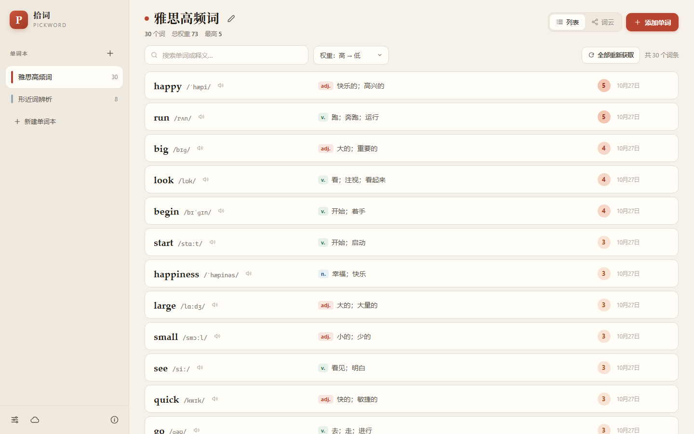
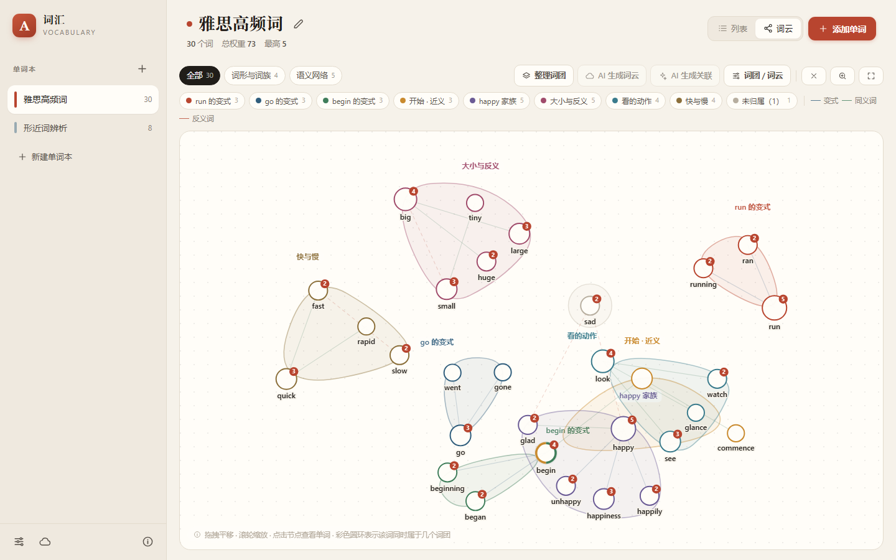
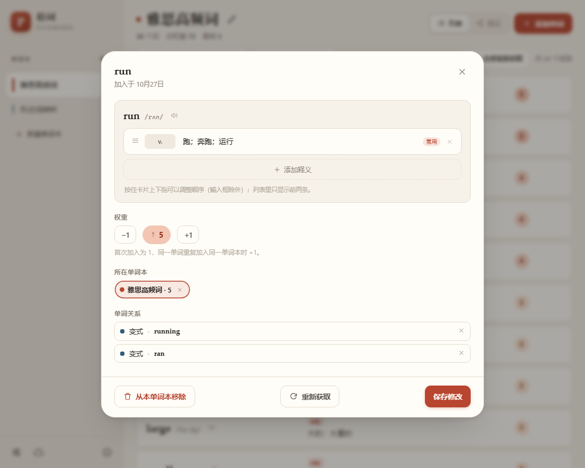
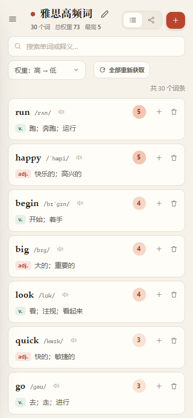

# 拾词 · 电子英语单词本

**拾词（Pickword）是一个在浏览器中运行的电子英语单词本。**

> 名称来源：遇见一个单词时，将其「拾」入单词本；同一单词再次进入同一单词本时，其权重加 1。

应用为纯前端 PWA，零依赖、零构建，可直接在浏览器中运行，也可部署到任意静态托管服务，并通过浏览器「添加到主屏幕」作为独立应用使用。

录入单词时自动补全音标、发音、词性与中文释义；每个单词带有一个可见的**权重**；一个单词本既可按权重或时间排序，也可展开为可交互的**词云**（节点为单词，词团由变体、同义、反义、形近等关系构成，多个词团组成一个词云）。

<p align="center">
  
  <br>
  
  <br>
  
  
</p>

## 功能一览

| 能力 | 说明 |
| --- | --- |
| 多单词本 | 自定义名称与颜色，各自独立计数 |
| 录入单词 | 手动勾选目标单词本，或使用「AI 智能分类」自动判断 |
| 自动补全 | 音标、发音、词性、多义项中文释义；配置 AI 后中文质量更高 |
| 权重 | 首次加入为 1，同一单词再次进入同一单词本加 1，直接显示在单词旁 |
| 排序 | 按权重或加入时间排序，支持升序与降序 |
| 词云 | 自研力导向图，词团可部分重叠且视觉可辨；AI 可一键生成词团与词云 |
| 编辑 | 在详情中拖动排序释义卡片、修改词性与中文、添加自定义释义 |
| 自适应布局 | 同一网页适配桌面、平板与手机；可「添加到主屏幕」，以独立窗口离线使用 |
| 同步 | 可选 Supabase：登录后各设备共享同一份数据 |

> **在线试用**：<https://YiYicc008.github.io/pickword/index.html?demo>（`?demo` 载入示例数据）
> 若要自行运行，有三种方式（直接访问 / 本机服务器 / 部署为独立站点），见「一、先选一种用法」。

界面语言：简体中文　｜　实现：原生 JavaScript（ES Modules），零依赖、无构建步骤

---

## 一、先选一种用法

本应用有三种使用方式，择一即可。

| 用法 | 适用情形 | 开始方式 |
| --- | --- | --- |
| **① 直接使用已部署的网址** | 仅需使用，无需安装 | 打开 `https://YiYicc008.github.io/pickword/`（示例数据：`…/index.html?demo`） |
| **② 在本机运行** | 需要完全离线，数据仅保存在本机 | 双击 `start.bat`，其他设备连接同一 WiFi 后访问 |
| **③ 部署为独立站点** | 需要独立地址，任意设备随时访问 | 见第 3 小节 |

以下三节依次说明：**① 直接访问**、**② 在本机运行**、**③ 部署为独立站点**。

### 1. 用法 ①：直接使用已部署的网址

无需安装任何组件。

1. 在电脑、iPad 或手机浏览器中打开 `https://YiYicc008.github.io/pickword/`；
2. 如需先查看示例数据，在上述地址后加 `?demo`：`https://YiYicc008.github.io/pickword/index.html?demo`；
3. 添加到主屏幕后，离线亦可使用（见第 4 小节）。

> 各设备共享同一份单词本需另行配置云同步（第四节）。未配置时，数据分别保存在各自的浏览器中，功能不受影响。

### 2. 用法 ②：在本机运行（局域网，无需公网）

双击 **`start.bat`**。脚本将执行以下操作：

1. 启动本地服务（默认 `http://127.0.0.1:8080`）；
2. 自动以默认浏览器打开页面；
3. 在控制台输出可供手机、平板访问的局域网地址，例如：

```
==============================================================
  拾词 · 电子英语单词本
==============================================================

  本机访问（这台电脑）：http://127.0.0.1:8080/index.html
  同一 WiFi 下的手机 / 平板访问：
      http://192.168.1.7:8080/index.html

  按 Ctrl+C 停止服务。
==============================================================
```

> **该窗口须保持运行**：它即为本地服务器，关闭窗口后页面将无法访问，重新双击 `start.bat` 即可恢复。
> 若 8080 端口已被占用，脚本会自动顺延至 8081、8082 等端口，以窗口输出的地址为准。
>
> 启动脚本会优先使用 **Node.js**（`serve.mjs`，并发处理更佳），未安装时回退 **Python 3**（`serve.py`）；
> 两者均为零依赖，择一安装即可：
> Node.js 可从 <https://nodejs.org/> 下载；Python 3 可从 <https://www.python.org/downloads/> 下载，
> 安装时勾选 *Add python.exe to PATH*。
> 也可以将整个目录放置于任意静态服务器；公开访问请使用「用法 ③」，无需本机脚本。

### 3. 用法 ③：部署为独立站点（GitHub Pages）

将整个目录发布到 GitHub Pages，即可获得公网地址。本项目当前使用的地址为
`https://YiYicc008.github.io/pickword/`。部署后可脱离局域网，在任何网络下访问；
添加到主屏幕后可离线使用。（跨设备共享数据仍需配置第四节云同步。）

1. 在 GitHub 新建仓库，推送整个目录：

   ```bash
   git init
   git add .
   git commit -m "init: 拾词 · 电子英语单词本"
   git branch -M main
   git remote add origin https://github.com/YiYicc008/pickword.git
   git push -u origin main
   ```

2. 进入仓库 **Settings → Pages**：Source 选择 `Deploy from a branch`，Branch 选择 `main`，目录保持 `/(root)`，点击 Save。

3. 等待一至两分钟，访问 `https://YiYicc008.github.io/pickword/`；
   如需示例数据，在地址后加 `?demo`：`…/index.html?demo`。

4. 添加到主屏幕的方法见第 4 小节。

**访问范围与数据归属**

- 公开仓库的 Pages 页面对外公开：持有链接者均可打开，无需登录；
- 数据保存在各访问者本人的浏览器中，彼此不可见；需要同步者须使用自己的 Supabase 项目（第四节）；
- 私有仓库使用 Pages 需 GitHub Pro，公开仓库免费。

补充说明：

- 所有资源均使用相对路径，部署于子目录（`https://…/pickword/`）亦可正常工作；
- 根目录的 `.nojekyll` 用于跳过 Jekyll 处理，避免下划线开头或名称特殊的文件被忽略；
- 亦可改用 Netlify、Vercel、Cloudflare Pages 等纯静态托管服务，将目录上传即可；
- 仅需局域网使用时，无需执行本节，按「用法 ②」运行 `start.bat` 即可。

### 4. 添加到主屏幕（三种用法通用）

在手机或平板中打开地址：

- **用法 ①**：直接打开 `https://YiYicc008.github.io/pickword/`，任何网络均可；
- **用法 ②**：设备连接与电脑相同的 WiFi，打开 `start.bat` 窗口输出的局域网地址（如 `http://192.168.1.7:8080/index.html`）；
- **用法 ③**：部署完成后即为用法 ① 的地址，打开方式相同。

随后添加到主屏幕，即可像独立应用一样启动：

- **iPad（Safari）**：分享 → 添加到主屏幕
- **Android / HarmonyOS（浏览器）**：菜单 → 添加到桌面
- **Windows（Chrome / Edge）**：地址栏右侧的「安装」图标

界面自动适配：桌面为左右分栏；手机为抽屉式侧栏与单列卡片，词云切换为紧凑模式。

### 5. 查看示例数据

在地址后加 `?demo`，例如 `https://YiYicc008.github.io/pickword/index.html?demo`（本机为
`http://127.0.0.1:8080/index.html?demo`），将载入两个示例单词本（雅思高频词 30 个、形近词辨析 8 个）、
9 个词团与 3 个词云。示例数据仅在「仅有一个空单词本」时写入。

---

## 二、功能说明

### 单词本

- 左侧边栏（手机上位于抽屉内）列出一个或多个单词本，每个单词本可**自定义名称与颜色**；
- 侧栏中点击 `+` 新建；右键单词本可重命名、清空或删除；
- 顶部标题旁的铅笔按钮亦可直接改名。

### 录入单词

点击右上角 **添加单词**（桌面快捷键 `n`）：

- 可一次录入多个单词，以**逗号或换行**分隔；
- 通过圆点标签选择目标单词本，**支持多选**；单词将同时进入每个选中的单词本，各自独立计数；
- 点击 **AI 智能分类**：由 AI 判断该词应归入哪些单词本并自动勾选（被 AI 选中的标签带有 `AI` 角标）；
- 录入时自动补全**音标、词性、多义项中文释义与发音音频**：
  - 音标、词性与发音来自免费词典 API（<https://dictionaryapi.dev>，需联网，结果在本机缓存 30 天）；
    音标取同一词条中出现次数最多的写法，生僻 IPA 字符统一为常见字形，避免字体缺字；
  - **单词存在多个义项时，按词性各列一条**（最多 4 条），如 `v. 快速移动`、`n. 跑步的行为或例子`；
    列表中显示前两条（中文重复者合并，末尾提示「还有 N 个义项」），详情弹窗显示全部（含英文释义与例句）；
  - 词性按该词性下的释义数量从多到少排列，避免罕用词性排在常用词性之前；
  - 中文释义优先由 AI 逐条翻译，未配置 AI 时逐条翻译英文释义并压缩为短语；
  - **常用义项优先**：每个单词另有一行「常见释义」（详情中带底纹的「常见」行），取自整词的高频译法并按常用度排序；
    仅当词典义项与该行对应时，列表才按词性逐条展开，否则仅显示常见释义；
  - 词典中与常见释义不对应的古义、罕用义项，在详情中淡化显示并标注「冷僻」；
  - **发音**按优先级依次尝试：有道发音（语速快、覆盖广）→ 词典自带的音频文件 → 浏览器语音合成，
    以避免单一音频源不可用时出现「点了没声音」；
  - 词典接口偶有限流或故障，此时单词仍会加入，释义留空，工具栏出现 **补全释义 N** 按钮，
    点击后将缺失音标或释义的单词重新查询（详情中的 **重新获取** 按钮作用相同）。

### 全部重新获取

工具栏右侧的 **全部重新获取** 将对**当前单词本内所有单词**重新查询音标、发音、词性与释义：

- 适用于「录入时接口异常、较多单词释义为空或不准，需要整体刷新」的情形；
- 词典接口存在速率限制，程序逐个查询（每次间隔 0.4 秒），30 个单词约需半分钟至一分钟；
- 查询过程中单词**逐个更新**，按钮显示为 `取消 · 12/30`，可随时点击停止；
- **仅覆盖查询成功的内容**：查询失败的单词保留原有释义，不会被清空；
- **手动编辑过的单词默认不被覆盖**：点击「全部重新获取」后先显示确认框，其中含一项
  「覆盖手动编辑过的 N 个单词」；勾选后点击「开始」，将列出被手动修改过释义的单词（支持全选），
  仅覆盖勾选者（「全选」与「清空」为两个独立按钮）；未勾选的单词只更新音标与发音，释义保持原样；
  不勾选直接开始，则全部保留；
  详情中的 **重新获取** 使用同一套确认流程（仅针对当前单词）；
- 免费翻译接口（MyMemory）每日有调用额度，短时间大量请求会返回 `429`；此时程序自动停止并提示
  「翻译接口限流」，已处理的结果正常保存，其余可在稍后重试；同一单词的结果按整词缓存，
  重复刷新不会重复消耗额度；
- 如希望一次完成且不受额度限制，可在 **设置 → AI 服务** 中填写 DeepSeek 或 OpenAI 的 Key，
  义项翻译将更准确、更简短（Key 仅保存在本机浏览器）。

### 编辑释义（排序、词性与中文）

打开任一单词的详情，最上方的释义卡片可直接编辑：

- **词性**：点击左侧 `v.` / `n.` / `adj.` 输入框，可输入缩写或中文（`v.`、`verb`、动词、短语等），保存时统一为同一类标签；
- **中文**：点击中文内容直接编辑；
- **拖动排序**：按住卡片（输入框与按钮以外的区域，或左侧 `⋮⋮` 手柄）上下拖动，
  卡片浮起并跟随指针移动，原位置保留虚线占位框以提示落点；
  松手后落位，保存后列表按此顺序显示；
  触屏设备为避免与页面滚动冲突，请**按住左侧 `⋮⋮` 手柄**拖动；
- **添加释义**：卡片区底部为虚线框「+ 添加释义」，点击后新增一张空卡片，填写词性与中文即可（适用于习语、专有含义等）；
- **删除**：点击卡片右侧 `×`；
- 首张卡片标注「常用」，与其语义不对应的义项标注「冷僻」并淡化，便于识别生僻义项；
- 列表中每个单词仅显示前两条释义，其余在详情中查看。

**「手动编辑」的判定**：程序记录词典或 AI 最近一次给出的义项及其顺序作为基线，仅当内容与基线不同时才视为手动编辑。
因此，调整顺序后又恢复原样、添加卡片后又删除，均不会留下标记。

手动编辑过的单词，**列表按其排列顺序显示**。此后执行「重新获取」或「全部重新获取」时先询问是否覆盖：
默认保留其释义，仅刷新音标与发音；如需覆盖，可在弹出的列表中选定具体单词（支持全选）。

### 权重

- 单词首次进入某个单词本时，权重为 **1**；
- 同一单词再次进入**同一**单词本，权重**加 1**；
- 权重显示在每个单词右侧的圆形徽标中（列表中为数字；词云中体现为节点大小、右上角标与圆形直径）；
- 鼠标悬停于单词行时出现 `+` / `−` 按钮，单词详情中亦可手动调整；
- 顶部显示「总权重」与「最高」。

### 两种呈现方式

通过顶部右侧的 **列表 / 词云** 切换：

1. **列表**：按加入时间或权重排序，支持升序与降序（下拉框四项：权重 高→低、权重 低→高、
   时间 新→旧、时间 旧→新），并支持按英文或中文释义搜索。
2. **词云**：每个单词为圆形节点，节点之间以连线表示关系，关系越近距离越近：
   - **词团**（cluster）：一组相关单词，以同一色调的半透明轮廓圈定，例如「run 的变式」「happy 家族」「大小与反义」；
   - **词云**（cloud）：多个词团的集合；一个单词本可包含多个词云，通过顶部胶囊按钮切换；
   - **词团可重叠**：同一单词属于两个词团时，节点的**彩色圆环分段**显示两种颜色，
     词团轮廓相互交叠但不合并，视觉上仍可分辨归属；
   - 关系类型以线型区分：变式（实线蓝）、同义词（实线绿）、反义词（虚线红）、形近词（点线橙）；
   - 点击节点查看详情（音标、释义、所属词团、权重加一 / 减一、移出本单词本）；
   - 支持拖拽平移、滚轮或双指缩放，`适应` 按钮恢复全览；点击图例可临时隐藏对应词团。

### 整理词团与 AI 生成

词云视图右上角提供以下操作：

- **整理词团**：依据已有关系自动聚类为词团（变式归为一族，同义、反义、形近各成一团），可重复执行；
- **AI 生成词云**：将整个单词本交由 AI **自行决定分组方式**，从同义、反义、形近、同词根、同主题等角度
  归纳若干词团，并组织为一至三个词云（手动词团予以保留）；
- **AI 生成关联**：由 AI 判断词与词两两之间的关系（变式、同义、反义、形近），绘制连线并重新聚类；
- **词团 / 词云**：手动管理，可新建、改名、改色、勾选成员、删除，并可将词团归属到指定词云。

---

## 三、配置 AI（可选，建议配置）

`设置` → **AI 服务**：

| 项目 | 说明 |
| --- | --- |
| 服务 | DeepSeek / OpenAI / Moonshot / 自定义（任意 OpenAI 兼容接口） |
| 接口地址 | 默认已填写，例如 `https://api.deepseek.com/v1` |
| 模型 | 例如 `deepseek-chat`、`gpt-4o-mini` |
| API Key | 仅保存在本机浏览器（localStorage），不会上传至任何第三方 |

填写后点击 **测试连接**。AI 用于三项功能：录入时的**智能分类**、缺少释义时的**中文翻译**、
词云中的**关系生成**。未配置 AI 亦可使用，上述三项需手动完成。

---

## 四、多设备同步（可选）

本节仅解决「多台设备看到同一份数据」的问题。未配置时亦可正常使用，各设备的数据分别保存在其浏览器的
`localStorage` 中。有三种选择：

| 方案 | 需要做什么 | 数据保存在 | 适用情形 |
| --- | --- | --- | --- |
| **不配置** | 无 | 本机浏览器 | 单设备使用，或自行导出备份 |
| **免注册（匿名）** | 点击一次 | 云端 | 需要防清理缓存、换浏览器后仍可取回 |
| **邮箱账号** | 注册一次 | 云端 | 多台设备共享同一份单词本 |

同步基于 [Supabase](https://supabase.com) 免费版：一张表、配置一次，数据保存在**使用者本人的项目**中。

`anon public key` 为公开信息，仅标识所访问的项目；某一行数据能否读写，由行级安全策略与请求所携带的登录身份共同决定。
因此同步需要一个身份：邮箱账号，或由 Supabase 分配的匿名账号（与本浏览器绑定，无需邮箱与密码）。

### 方案一：不配置

直接使用即可。建议定期在 `设置 → 数据 → 导出备份` 保存 JSON，以避免浏览器清理缓存导致数据丢失。

### 方案二：免注册（匿名）

1. 打开 `设置 → 云同步`；
2. 若站点已内置云服务，第 1 段会显示「本站已内置云服务」，无需填写；否则先填写 URL 与 anon key 并保存；
3. 点击 **免注册使用（匿名）**，随即可点击 **立即同步**。

局限：匿名账号与本浏览器绑定，清除站点数据后无法找回；如需多台设备共享，请改用方案三。
自建项目时，须先在 Supabase 的 `Authentication → Sign In / Providers` 中开启 `Anonymous sign-ins`。

### 方案三：邮箱账号（跨设备共享）

#### 1. 创建 Supabase 项目

1. 打开 <https://supabase.com> → `Start your project`，使用 GitHub 或邮箱注册（免费计划即可）；
2. `New project`：填写项目名（例如 `pickword`），设置**数据库密码**（请自行保管，一般无需使用），
   区域选择较近的节点（如 `Singapore` / `Tokyo`）→ `Create new project`，等待 1–2 分钟完成初始化。

#### 2. 获取两项配置

进入项目后，点击左侧 **Project Settings → API**（新版位于 `Data API` / `API Keys`），复制：

| 名称 | 形如 | 用途 |
| --- | --- | --- |
| **Project URL** | `https://abcdefgh.supabase.co` | 数据地址 |
| **anon public key** | `eyJhbGciOi…`（较长） | 匿名公开密钥，可用于前端 |

> 请勿填写 `service_role` key：它绕过全部安全策略，泄露即等同于交出数据库。
> anon key 本身即为公开信息，其安全性由第 3 步的行级安全策略（RLS）保证，而非依赖密钥保密。

#### 3. 创建数据表（仅需一次）

1. 左侧 **SQL Editor** → `New query`；
2. 将 [`supabase/schema.sql`](supabase/schema.sql) 的全部内容粘贴进去 → **Run**；
3. 出现 `Success. No rows returned` 即为成功。该脚本完成三件事：创建 `public.vn_state` 表
   （字段 `user_id`、`data jsonb`、`updated_at`）、启用 RLS、添加策略 `using (auth.uid() = user_id)`，
   即**每个账号只能读写自己的记录**。

如需确认：在左侧 **Table Editor** 中可见 `vn_state`，且右上角显示 `RLS enabled`。

#### 4. 账号设置

左侧 **Authentication → Providers → Email** 默认已启用。
默认同时启用 `Confirm email`：注册后须**点击邮件中的链接**方可登录。
如仅本人使用、不希望反复验证邮件，可关闭 `Confirm email`
（Authentication → Providers → Email → 取消勾选），注册后即可直接登录。

#### 5. 在应用中填写配置

应用 → **设置 → 云同步**：

1. 第 1 段填写 **Project URL** 与 **anon public key**，点击 **保存配置**；
2. 第 2 段填写邮箱与密码（至少 6 位），点击 **注册新账号**；若启用了邮件确认，先前往邮箱点击链接；
3. 点击 **登录**，成功后该段显示当前账号与上次同步时间。

（配置与 AI Key 一样仅保存在本机浏览器，并随同步写入云端，更换设备登录后无需重新填写。）

#### 6. 多设备同步

先在任意一台设备上登录并点击 **立即同步**，该设备数据即上传至云端；
其余设备打开同一网址 → 设置 → 云同步 → 填写相同的 URL 与 key → 登录同一账号 → **立即同步**。

同步逻辑为**先拉取云端、与本机合并、再上传**。合并按「单词本 id + 单词 id」对齐，
同一单词在两台设备上权重不同时**取较大值**（不会因同步导致权重降低），关系与词团按 id 合并。

| 按钮 | 行为 | 适用情形 |
| --- | --- | --- |
| 立即同步 | 拉取 + 合并 + 上传 | 日常使用，各设备各执行一次 |
| 从云端恢复 | 以云端数据**完全覆盖本机** | 本机误删或更换设备，以云端为准 |
| 上传本机 | 以本机数据**覆盖云端** | 云端数据异常，本机为准 |

### 从匿名账号转为邮箱账号

目前的做法是：在「设置 → 数据」导出 JSON → 退出登录 → 用邮箱注册并登录 → 导入 JSON → 执行一次「立即同步」。
数据不会因更换账号而丢失。

### 常见问题

**提示「该项目未开启匿名登录」**
在 Supabase 的 `Authentication → Sign In / Providers` 中开启 `Anonymous sign-ins` 后重试；或改用邮箱账号。

**登录提示 `Invalid login credentials`**
账号尚未完成注册（多为未点击邮件中的确认链接），或密码错误。可重新点击「注册新账号」后再试。

**提示「云端的 vn_state 数据表还没有创建」**
第 3 步的 SQL 未执行成功。请返回 SQL Editor 重新执行 `supabase/schema.sql`。

**登录成功但同步报 401 或权限错误**
通常为策略缺失。在 SQL Editor 中执行 `alter table public.vn_state enable row level security;`，
再确认策略存在：`select * from pg_policies where tablename = 'vn_state';`

**免费额度是否够用**
够用。免费计划每月提供 500 MB 数据库与 5 GB 出网流量；单词本完整同步一次仅数十至数百 KB。

**数据是否会被他人看到**
不会被其他访问者看到。表已启用 RLS，策略为 `auth.uid() = user_id`，数据库层面即拒绝跨账号读取。

## 五、目录结构

```
English Dictionary/
├── index.html              应用外壳
├── manifest.webmanifest    PWA 清单（名称、图标、独立窗口）
├── sw.js                   离线缓存（应用外壳，网络优先）
├── start.bat               Windows 一键启动（优先使用 Node，回退 Python）
├── serve.mjs               本机静态服务器（Node 版，零依赖）
├── serve.py                局域网静态服务器与地址提示
├── LICENSE                 MIT 许可
├── .nojekyll               关闭 GitHub Pages 的 Jekyll 处理
├── supabase/
│   └── schema.sql          云同步建表 SQL（在 Supabase SQL Editor 中执行一次）
├── docs/                   README 使用的截图
├── css/
│   ├── app.css             设计系统与主要布局（含响应式断点）
│   └── cloudview.css       词云视图样式
├── js/
│   ├── app.js              入口：启动、事件、快捷键
│   ├── store.js            数据层（单词本、单词、词条、权重、关系、词团、词云、设置）
│   ├── viewstate.js        视图状态（当前单词本、排序、搜索等）
│   ├── views.js            侧栏、顶栏、列表、详情、设置与同步弹窗
│   ├── entry.js            添加单词弹窗
│   ├── cloudview.js        词云视图
│   ├── graph.js            力导向图引擎（自研 canvas，支持重叠词团）
│   ├── cluster.js          自动聚类与形态变式推导
│   ├── dict.js             词典 API、翻译与发音
│   ├── ai.js               AI 接口（分类、翻译、关系）
│   ├── sync.js             Supabase 登录与同步（含免注册的匿名身份）
│   ├── config.js           站点内置的云服务配置（可选，留空则由用户自填）
│   ├── demo.js             示例数据
│   ├── format.js           词性缩写等格式化
│   ├── ui.js               图标、弹窗与提示
│   └── util.js             通用工具
└── assets/                 应用图标（SVG 与 PNG）
```

数据全部保存在浏览器 `localStorage`（键名 `vn.state.v2`），亦可通过 `设置 → 数据 → 导出备份` 保存为 JSON 文件。

---

## 六、备份与回滚

数据层面有两种保障：`设置 → 数据 → 导出备份`（生成 JSON 文件），以及第四节的云同步。
代码层面使用常规 git 仓库：

```bash
git log --oneline          # 查看历史
git diff HEAD~1            # 查看上一次改动
git checkout -- .          # 丢弃未提交的改动
git revert <commit>        # 撤销指定提交
```

回滚前建议先提交当前进度，或复制整个目录另存一份。

---

## 七、常见问题

**点击喇叭无声音**
发音使用浏览器内置语音合成或词典音频。iPad 需在系统设置中允许 Safari 播放声音；
台式机未安装英文语音包时，将回退至词典音频。

**手机无法打开电脑地址**
请确认两台设备连接同一 WiFi；Windows 防火墙首次会询问，选择「允许访问」。
也可参照「用法 ③」将目录部署到静态托管服务，各设备使用同一 https 地址，离线缓存亦可生效。

**添加到主屏幕后显示空白页**
首次打开需正常加载一次（Service Worker 须注册成功）。使用 `http://` 局域网地址时，
部分浏览器仅在 https 或 localhost 下启用离线缓存，但正常使用不受影响。

**更换设备后数据丢失**
数据默认仅保存于本机。请先配置云同步并同步一次，或导出 JSON 后导入。

**需要清空重来**
`设置 → 数据 → 清空` 将删除所有单词本与词条；仅清空一个单词本时，右键该单词本选择「清空」。

---

## 八、数据与隐私

- 默认**纯本地**：单词本、词条、权重、词团均保存在本机浏览器的 `localStorage`（键 `vn.state.v2`），不上传任何服务器；
- AI Key 与 Supabase 配置同样仅保存在本机，不写入代码或仓库（仓库中仅有占位提示文字）；
- 仅当使用者在设置中配置 Supabase 并登录后，数据才会同步至其**本人**的 Supabase 项目；
  建表 SQL 见 [`supabase/schema.sql`](supabase/schema.sql)，每条记录均有行级安全策略，仅本人可读写；
- 更换设备或清理浏览器缓存前，请先「导出 JSON」备份，或先配置云同步并同步一次。

## 九、参与贡献

Issue 与 PR 均欢迎。提交前请留意三项约定：

- **零依赖、无构建**：不引入 npm 包或编译步骤，保持浏览器可直接运行的原生 ES Modules；
- **数据向后兼容**：`store.js` 的 state 含 `version` 字段，新增字段须保证旧数据可读（缺失字段以默认值兜底）；
- **自查**：以 `index.html?demo` 打开，依次检查列表、词云、详情与设置；桌面宽度与手机宽度各看一次。

`?demo` 相关 URL 参数：

| 参数 | 作用 |
| --- | --- |
| `?demo` | 载入示例数据（两个单词本、38 个单词、9 个词团、3 个词云） |
| `?demo&view=cloud` | 直接打开词云视图 |
| `?demo&modal=add` | 直接打开「添加单词」 |
| `?demo&modal=settings` / `sync` / `about` | 直接打开设置 / 云同步 / 关于 |
| `?demo&modal=manager` | 直接打开「词团与词云」管理器 |

## 更新日志

各版本的软件改动见 [CHANGELOG.md](CHANGELOG.md)；当前版本为 1.1.0.0。

## 许可证

[MIT](LICENSE)
